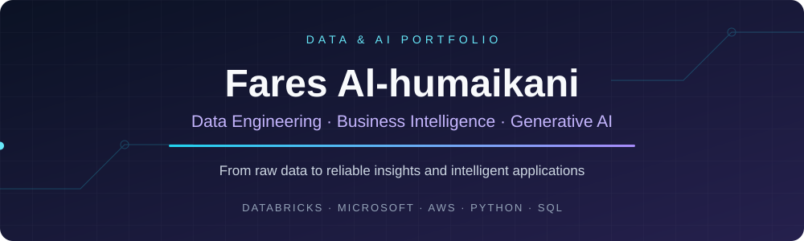
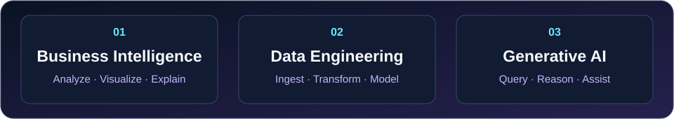
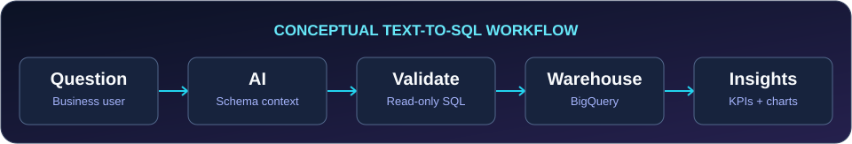

<div align="center">


[](https://www.linkedin.com/in/faresalhumaikani/)
[](https://github.com/faresnl)
[](https://github.com/faresnl?tab=followers)

</div>

## 🪟 About

<table>
<tr>
<td valign="top" width="55%">

My focus is building data-driven solutions that connect business questions with reliable data and actionable insights. My portfolio spans retail analytics, cloud data platforms and natural-language BI applications.

I bring together SQL, Python, Power BI and cloud technologies, with credentials from Databricks, Microsoft and AWS.

</td>
<td valign="top" width="45%">

```yaml
focus:
  - Data Engineering
  - Business Intelligence
  - Generative AI
languages: [Python, SQL]
analytics: [Power BI, Excel]
platforms: [Azure, AWS, GCP, Databricks]
applications: [Streamlit]
```

</td>
</tr>
</table>


## 🧩 Three pillars



| Data Engineering | Business Intelligence | Generative AI |
|:---|:---|:---|
| ETL and data modeling | SQL analysis and KPIs | Natural-language analytics |
| Lakehouse concepts | Retail dashboards | Text-to-SQL workflows |
| Cloud data platforms | Data visualization | SQL validation and guardrails |

## 🛠️ Technology stack

| Domain | Tools |
|---|---|
| Analytics & BI |    |
| Programming & applications |    |
| Cloud & data platforms |       |
| 📈 Monitoring & Observability |  |


## 🚀 Featured projects

### [Talk to My Data — Generative AI for Retail BI](https://github.com/faresnl/talk-to-my-data-project)

**Business question:** How can retail sales teams explore performance without writing SQL?

| | Project overview |
|---|---|
| Solution | Collaborative capstone designing a natural-language analytics assistant with schema-aware SQL generation, validation and visual responses. |
| Business metrics | Revenue trends, average order value, product performance and category revenue share. |
| Dataset | Global Electronics Retailer — sales, products, customers, stores and exchange rates. |
| Technology | Python · SQL · BigQuery (GCP) · FastAPI · Streamlit |
| Evidence | [Architecture, dataset schema and project plan](https://github.com/talk-to-my-data-project#readme) |
| Live demo | [Watch project video on YouTube](https://www.youtube.com/watch?v=l5f0BkeYtMU) |

### [De Buurtwinkel — Retail Sales Analytics](https://github.com/faresnl/debuurtwinkel-dashboard)

**Business question:** How can retailers monitor sales performance across products, stores and regions?

| | Project overview |
|---|---|
| Solution | Interactive Streamlit recreation of a Power BI retail dashboard. |
| Analysis | Sales and product performance, geographic comparisons and KPI reporting. |
| Dataset | Sales transactions, product details and store locations. |
| Technology | Python · Streamlit · Power BI dashboard design |
| Evidence | [Data requirements and local setup](https://github.com/faresnl/debuurtwinkel-dashboard#readme) |
| Live demo | [Open interactive dashboard](https://debuurtwinkel-dashboard-hgw7fezcxthesh6nybuqhm.streamlit.app/) |
| Reproducibility | Requires the original CSVs or compatible, shareable sample data. |

<sub>Project descriptions reflect documented scope. Measured findings and individual capstone contributions will be added when verified. The De Buurtwinkel demo link is supplied by the project owner.</sub>

### 🔍 Architecture spotlight — Talk to My Data



<details>
<summary><b>Explore the capstone architecture</b></summary>

| Layer | Purpose |
|---|---|
| Data platform | Retail data preparation and BigQuery warehouse |
| AI | Schema-aware natural-language to SQL generation |
| Backend | Read-only query validation and KPI computation |
| Presentation | Tables, charts and natural-language summaries |

This is the collaborative project architecture; see the repository for implementation scope and team contributions.

</details>


## 🏅 Certifications

<div align="center">

Professional certifications &amp; continuous learning across data, AI and cloud.

<table>
<tr><th colspan="3" align="center">DATA &amp; AI CERTIFICATIONS</th></tr>
<tr>
  <td align="center" valign="top" width="250">
    <br/>
    <a href="https://credentials.databricks.com/cef6061b-066e-4df1-8399-0255ee0681cc#acc.7wLBqIOk"></a>
    <br/><br/>
    <b>Databricks Certified<br/>Data Engineer Associate</b>
    <br/><sub>Databricks</sub>
    <br/><br/>
    <a href="https://credentials.databricks.com/cef6061b-066e-4df1-8399-0255ee0681cc#acc.7wLBqIOk">Verify</a>
    <br/><br/>
  </td>
  <td align="center" valign="top" width="250">
    <br/>
    <a href="https://learn.microsoft.com/en-us/users/faresh/credentials/948cfdf4963e63f6"></a>
    <br/><br/>
    <b>Microsoft Certified<br/>Azure AI Cloud Developer<br/>Associate (AI-200)</b>
    <br/><sub>Microsoft</sub>
    <br/><br/>
    <a href="https://learn.microsoft.com/en-us/users/faresh/credentials/948cfdf4963e63f6">Verify</a>
    <br/><br/>
  </td>
  <td align="center" valign="top" width="250">
    <br/>
    <a href="https://www.credly.com/badges/dfb90f86-5549-4286-b896-5529743bb2ad"></a>
    <br/><br/>
    <b>Microsoft Certified<br/>Azure Fundamentals (AZ-900)</b>
    <br/><sub>Microsoft</sub>
    <br/><br/>
    <a href="https://www.credly.com/badges/dfb90f86-5549-4286-b896-5529743bb2ad">Verify</a>
    <br/><br/>
  </td>
</tr>
<tr><th colspan="3" align="center">CERTIFICATIONS IN PROGRESS</th></tr>
<tr>
  <td colspan="3" align="center">
    <br/>
    <a href="https://learn.microsoft.com/en-us/credentials/certifications/power-bi-data-analyst-associate/"></a>
    <br/><br/>
    <b>Microsoft Certified: Power BI Data Analyst Associate (PL-300)</b>
    <br/><sub>In progress · Exam date: 30 Jan 2027</sub>
    <br/><br/>
    <a href="https://learn.microsoft.com/en-us/credentials/certifications/power-bi-data-analyst-associate/">Certification details</a>
    <br/><br/>
  </td>
</tr>
<tr><th colspan="3" align="center">PREVIOUSLY EARNED AWS CERTIFICATIONS</th></tr>
<tr>
  <td align="center" valign="top" width="250">
    <br/>
    <a href="https://www.credly.com/badges/88b62b68-021d-4c63-b0ee-f7ff7dff7699"></a>
    <br/><br/>
    <b>AWS Certified<br/>Solutions Architect – Associate</b>
    <br/><sub>AWS · Previously earned</sub>
    <br/><br/>
    <a href="https://www.credly.com/badges/88b62b68-021d-4c63-b0ee-f7ff7dff7699">Verify</a>
    <br/><br/>
  </td>
  <td align="center" valign="top" width="250">
    <br/>
    <a href="https://www.credly.com/badges/2b2db6c5-4383-4817-a0d8-506b13debcb7"></a>
    <br/><br/>
    <b>AWS Certified<br/>Developer – Associate</b>
    <br/><sub>AWS · Previously earned</sub>
    <br/><br/>
    <a href="https://www.credly.com/badges/2b2db6c5-4383-4817-a0d8-506b13debcb7">Verify</a>
    <br/><br/>
  </td>
  <td align="center" valign="top" width="250">
    <br/>
    <a href="https://www.credly.com/badges/c54d5557-c03c-43f3-99ee-1d759c126a64"></a>
    <br/><br/>
    <b>AWS Certified<br/>Cloud Practitioner</b>
    <br/><sub>AWS · Previously earned</sub>
    <br/><br/>
    <a href="https://www.credly.com/badges/c54d5557-c03c-43f3-99ee-1d759c126a64">Verify</a>
    <br/><br/>
  </td>
</tr>
<tr><th colspan="3" align="center">PROFESSIONAL DEVELOPMENT</th></tr>
<tr>
  <td align="center" valign="top" width="250">
    <br/>
    <a href="https://credentials.databricks.com/60f36f4f-0940-41d2-a28c-b97503f322db#acc.uw1NWreX"></a>
    <br/><br/>
    <b>Databricks<br/>Lakehouse Fundamentals</b>
    <br/><sub>Databricks · Accreditation</sub>
    <br/><br/>
    <a href="https://credentials.databricks.com/60f36f4f-0940-41d2-a28c-b97503f322db#acc.uw1NWreX">Verify</a>
    <br/><br/>
  </td>
  <td align="center" valign="top" width="250">
    <br/>
    <a href="https://www.coursera.org/account/accomplishments/verify/SS0LTNEZF1NQ"></a>
    <br/><br/>
    <b>IBM<br/>Tools for Data Science</b>
    <br/><sub>IBM · Coursera · Course certificate</sub>
    <br/><br/>
    <a href="https://www.coursera.org/account/accomplishments/verify/SS0LTNEZF1NQ">Verify</a>
    <br/><br/>
  </td>
  <td align="center" valign="top" width="250">
    <br/>
    <a href="https://www.coursera.org/account/accomplishments/verify/E76FSURNV2W7"></a>
    <br/><br/>
    <b>IBM<br/>What is Data Science?</b>
    <br/><sub>IBM · Coursera · Course certificate</sub>
    <br/><br/>
    <a href="https://www.coursera.org/account/accomplishments/verify/E76FSURNV2W7">Verify</a>
    <br/><br/>
  </td>
</tr>
</table>

<sub>Click a badge or its verification link to view the credential and current validity.</sub>

</div>


## 🎯 Current focus

- Developing end-to-end data engineering and lakehouse workflows.
- Applying SQL and Python to business intelligence problems.
- Exploring safe, schema-aware generative AI applications for analytics.
- Strengthening reproducibility and documentation across portfolio projects.


## 📈 GitHub analytics

<div align="center">


[Explore repositories](https://github.com/faresnl?tab=repositories) · [View contributions](https://github.com/faresnl)

</div>

## 🤝 Connect

<div align="center">

**Interested in data engineering, analytics and applied AI collaboration.**

[](https://www.linkedin.com/in/faresalhumaikani/)

</div>
